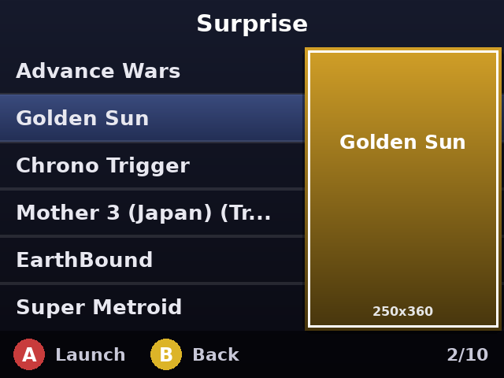

# Surprise

A native C + SDL 1.2 app for [Onion OS](https://github.com/OnionUI/Onion) on the Miyoo Mini. Open it from Apps → Surprise to see a short list of games picked for you, with box art, and launch one the way Onion does.

The list comes from `/mnt/SDCARD/Roms/surprise.json`, written by the separate `sync-roms` tool. See [docs/surprise-json.md](docs/surprise-json.md).



## Install

Extract `Surprise-<version>.zip` at the SD card root so `App/Surprise/` appears (it also installs `Icons/Default/app/surprise.png`), then open Apps → Surprise.

## Quick start (no sync-roms)

```sh
scripts/make-surprise-json.py /Volumes/<card> -n 10      # add --dry-run to preview
```

Picks random games that have `Imgs/<name>.png` box art and writes `Roms/surprise.json`.

## Build and test

```sh
scripts/build.sh          # cross-build in Docker (Colima) -> App/Surprise/surprise
make test                 # host unit tests + make-surprise-json test
scripts/preview.sh        # headless screenshots -> build/preview/*.png
scripts/package.sh        # build + dist/Surprise-<version>.zip (--no-build to skip the build)
scripts/deploy.sh <host> [--run]   # copy to a device over SSH (tar over one connection); --run launches it and prints log.txt (press B only, MainUI is still running)
scripts/make-icon.py      # regenerate surprise.png (uv run --with pillow)
```

On-device checklist: [docs/device-testing.md](docs/device-testing.md).

## Licence

Our code is MIT ([LICENSE](LICENSE)). cJSON (`vendor/cjson`) is MIT. The bundled fallback font is under the licence in `App/Surprise/res/font-LICENSE.txt`.
